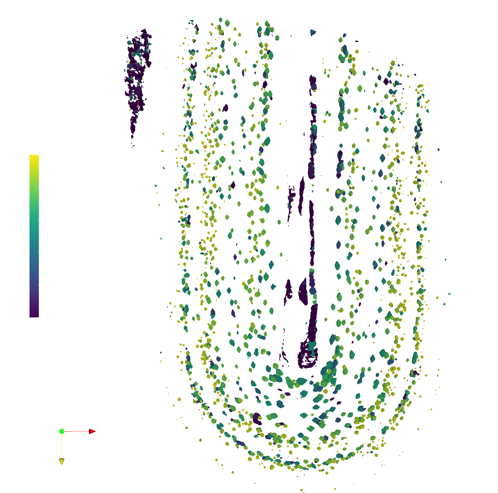
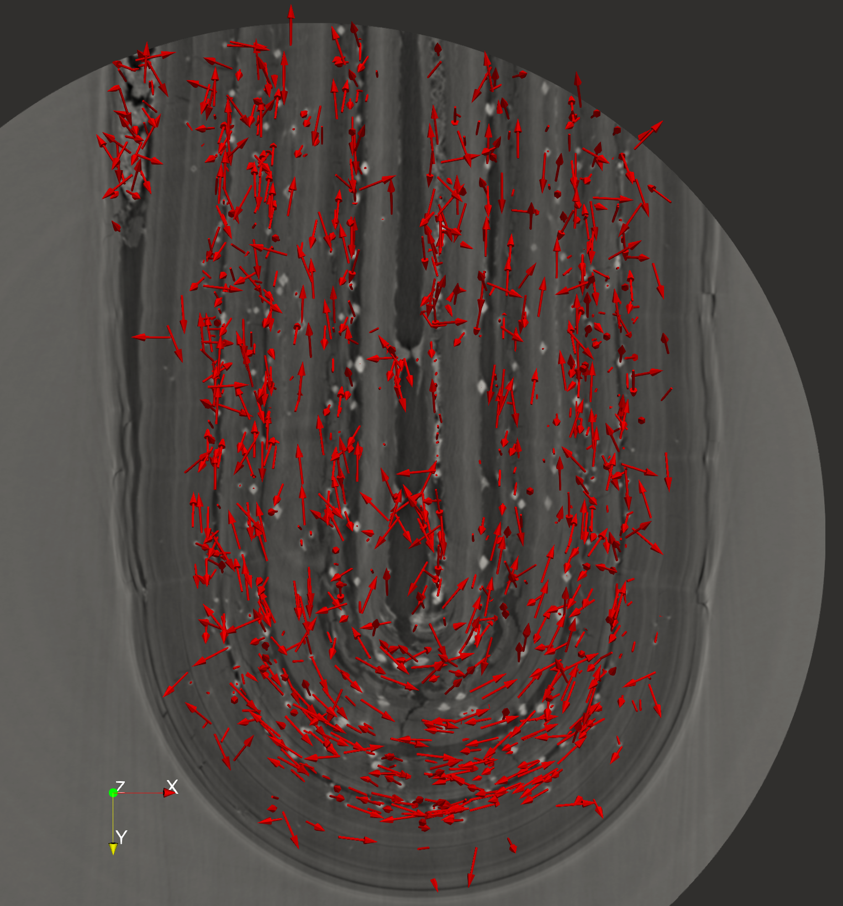
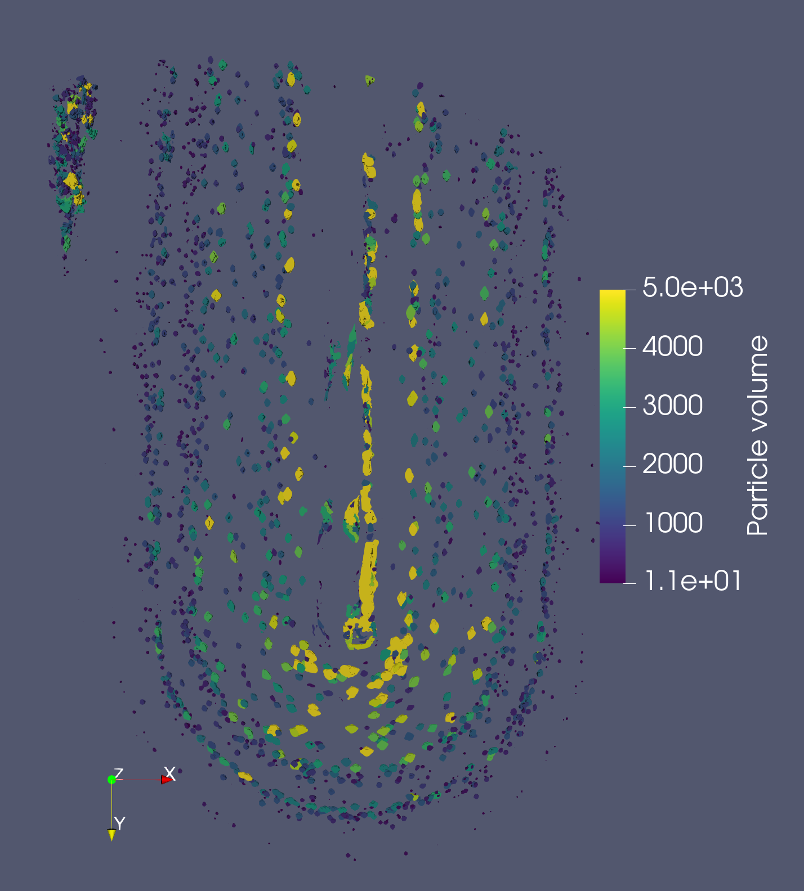
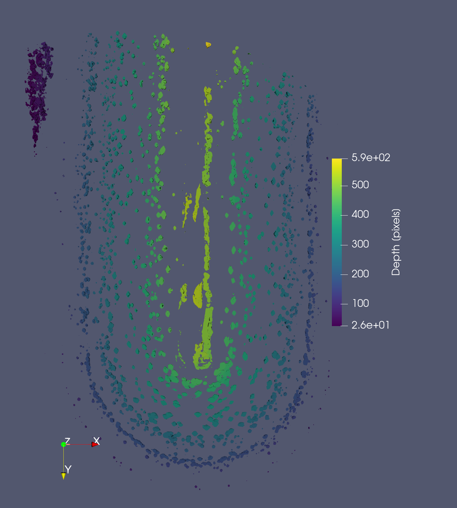

# 07-10/03/2022 - CERIC-Franceschin beamtime @ Elettra SYRMEP

Repository of the image processing software for (Franceschin et al., 2024)
> Franceschin, G., Zanini, R., Iori, G., Longo, E., Divitini, G., Tromba, G., & Traviglia, A. (2024). Non-destructive 3D exploration of silicate glass corrosion: A combined multiscale approach from the macro to the nanoscale. Physical Chemistry Chemical Physics, 26(12), 9697–9707. https://doi.org/10.1039/D3CP05221D

Image processing steps are described in the [Image processing notebooks](./notebooks) folder.

**Synchrotron microCT scan information:**

|Scan parameters|   |
|:-|:-|
|Beamline|SYRMEP@Elettra|
|Beamtime|20217193_Traviglia - CERIC|
|Sample|581681_patina/581681_punta_HR_stitch2 |
|Energy (mean)| 27 keV |
|Camera| ORCA flash |
|Voxel size| 1.0 um |
|SDD | 150 mm |
|Preliminary operations|[stitch of 4 scans](https://github.com/gianthk/recon_utils/tree/master/stitch_scan) (normalized; 2D rigid transform) |

---
particle sphericity | particle orientation
:-------------------------:|:-------------------------:
  |  

particle volume | particle depth
:-------------------------:|:-------------------------:
  |  

---
## Acknowledgements
We acknowledge the CERIC-ERIC Consortium for the access to experimental facility SYRMEP of ELETTRA and financial support for synchrotron measurements.  

---
Beamtime files (restricted access):
- [Beamtime log](https://docs.google.com/document/d/1fjyVFMCTpSvbUCNX24nXlbFs_4Q7dz0G9pO4Xdt3MnQ/edit?usp=sharing)
- [Beamtime master file](https://docs.google.com/spreadsheets/d/1ZFOwhJzm3khHMlIqH4ead-EV-TQC7OiZ/edit?usp=sharing&ouid=110158396991829805042&rtpof=true&sd=true)

